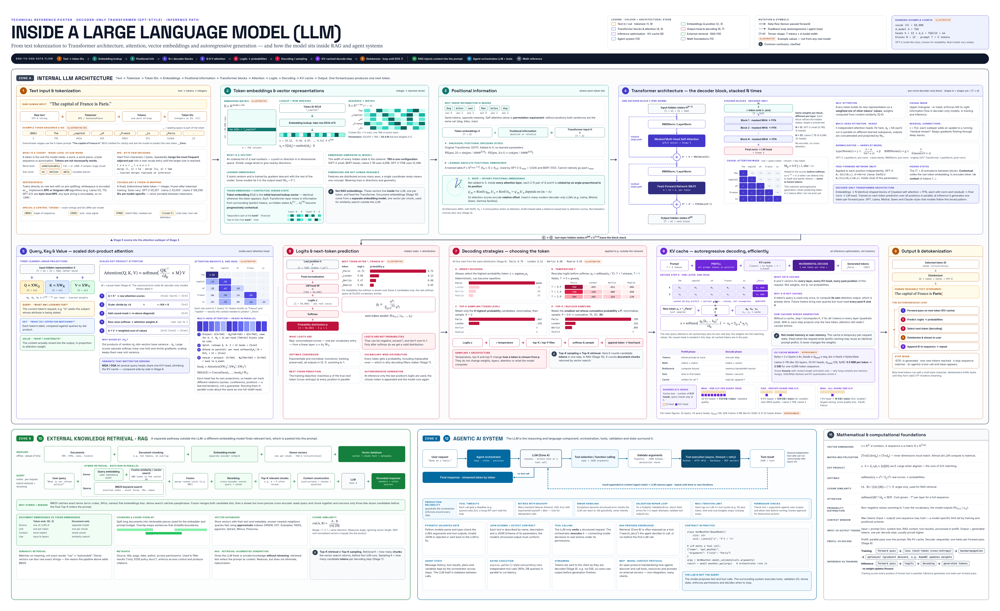

# Inside a Large Language Model (LLM)

**From text tokenization to Transformer architecture, attention, vector embeddings and autoregressive generation, plus where the LLM sits inside RAG and agent systems.**

📄 **[Open the full-resolution PDF](poster.pdf)** (best for zooming in)

---

## What the poster covers

**Zone A: inside the LLM** (decoder-only Transformer, GPT-style)

1. **Tokenization:** tokens vs words, BPE, SentencePiece, vocabulary, special tokens
2. **Token embeddings:** embedding lookup (50,000 × 768 example), static embeddings vs contextual hidden states
3. **Positional information:** sinusoidal, learned absolute, RoPE
4. **Transformer block:** pre-norm, masked multi-head self-attention, FFN, residuals, causal mask
5. **Q / K / V attention:** `softmax(QKᵀ/√dₖ + M)V`, per-head dimensions, multi-head concat
6. **Logits:** LM head, softmax, why logits ≠ probabilities
7. **Decoding:** greedy, temperature, top-K, top-P
8. **KV cache:** prefill vs decode, cache memory, MHA vs GQA vs MQA
9. **Detokenization:** the autoregressive loop and stop conditions

**Zone B: RAG.** Chunking, embedding models, vector databases, hybrid BM25 + dense retrieval, reranking, grounded responses.

**Zone C: agents.** Orchestrator, tool calling, Pydantic / JSON Schema, MCP, plus production guardrails: timeouts, retries, iteration limits, permission checks.

**Reference panel:** vectors, matrix multiplication, dot product, softmax, cosine similarity, context window, prefill vs decode, training vs inference.

---

## Common confusions it clears up

- Token embeddings ≠ document (RAG) embeddings
- Token embeddings ≠ contextual hidden states
- Logits ≠ probabilities
- Top-K sampling ≠ Top-K retrieval
- KV cache = temporary inference state, not model or user memory
- The LLM ≠ the agent

> All example numbers (token IDs, probabilities, attention weights, model sizes) are **illustrative**, chosen for readability rather than taken from a specific model.

---

## What I learned

- **No longer a black box.** I used to treat LLMs as a black box. Seeing how much math and engineering goes into producing every single token makes me appreciate them far more than I did before.
- **Connecting the dots.** It showed me how decades of machine learning research (embeddings, attention, normalisation, probability) finally came together to shape the modern LLM.
- **One giant prediction engine.** Each piece is complex engineering on its own, but together they work as one giant probability engine, running at enormous scale to predict the next token.
- **The engine behind agents.** That same next-token prediction is what fuels Agentic AI.

---

*Made with AI as a co-pilot, as part of [Learning AI with AI](../../README.md).*
